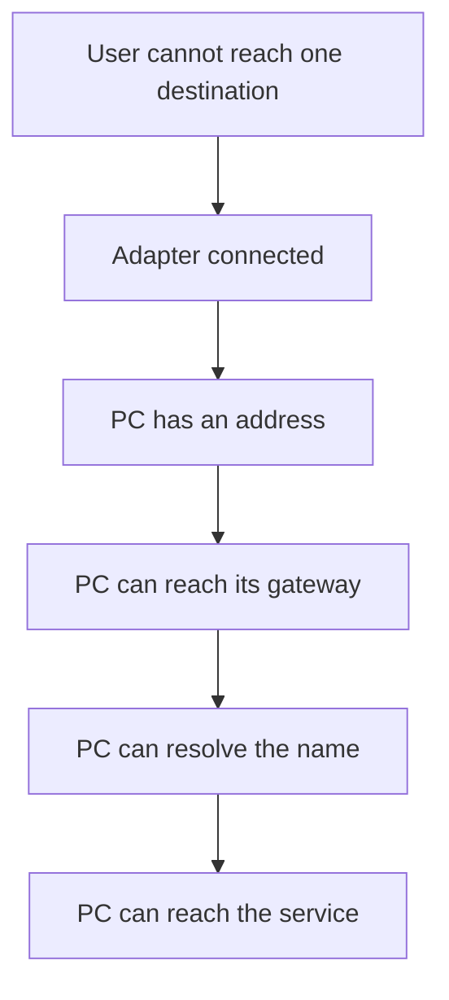

# Network troubleshooting

**Status: proposed procedure.** Use this when a user cannot reach a site, a share, a printer, or email. No connectivity test was run against a user network for this repository. The script validation did not call `ping`, `Test-NetConnection`, or `Resolve-DnsName`.

Find the first layer that fails and stop there. Fixing DNS settings will not help a PC that has no link light.



## 1. Define the failure

Write the exact name or address that fails, whether other sites work, and whether other people in the same room have the failure. One PC means you start on that PC. A whole room usually means the access point, the switch, or an upstream outage, and the right next step is to compare with a second PC before you rebuild the first one.

**Verification**

- [ ] The failing name or address is written down.
- [ ] You know if other destinations work.
- [ ] You know if a second PC on the same network has the same failure.

**Recorded result for this repository:** Not performed.

## 2. Check the adapter

Look at the Ethernet link light or the Wi-Fi icon. Then:

```powershell
Get-NetAdapter | Select-Object Name, Status, LinkSpeed, MacAddress
```

`Status` of `Up` means Windows sees the interface as connected. `Disconnected` on a wired port means the cable, the switch port, or a disabled adapter. `LinkSpeed` is the negotiated speed, such as `1 Gbps`. The MAC address identifies the NIC. You do not need it for a basic ticket, and you should not publish a list of addresses.

If Wi-Fi is up and the user is on a guest network, they may be online and still blocked from internal servers. Ask which network name they joined.

**Verification**

- [ ] The adapter name and status are on the ticket.
- [ ] A disconnected adapter was traced to cable, radio, or a disabled NIC before any IP changes.
- [ ] The joined Wi-Fi name is the one the user is supposed to use.

**Recorded result for this repository:** Not performed.

## 3. Read the address configuration

```powershell
ipconfig /all
```

Read these fields for the adapter that should be in use:

| Field | What a usable office PC usually shows |
| --- | --- |
| IPv4 Address | An address on the site's network. `169.254.x.x` means DHCP failed and Windows assigned an APIPA address. That PC will not reach the office. |
| Subnet Mask | Must match the site. A wrong mask makes some rooms reachable and others not. |
| Default Gateway | The router for this subnet. Blank means the PC has no path off its own subnet. |
| DHCP Enabled | `Yes` when the site uses DHCP. A manual address is a choice, not the default, unless the ticket says otherwise. |
| DNS Servers | Your company's DNS servers, or the resolver the site documents. `0.0.0.0` is not a working resolver. |

`ipconfig /all` also shows the host name and the physical address. Attach the useful lines to the ticket. Do not post the full output in a public place.

**Verification**

- [ ] IPv4 address, mask, gateway, and DNS server are written down.
- [ ] An address starting with `169.254` is treated as a DHCP failure.
- [ ] You identified which adapter the user is actually using.

**Recorded result for this repository:** Not performed.

## 4. Test the gateway

```powershell
ping <gateway-address>
```

Replace `<gateway-address>` with the gateway from `ipconfig`. A reply means this PC can reach the router with ICMP. "Request timed out" or "Destination host unreachable" means the local hop failed, or ICMP is blocked.

`ping` only proves ICMP. Some networks drop it. Pair a failed ping with the adapter status and the address before you tell the user the network is down.

**Verification**

- [ ] You pinged the gateway from `ipconfig`, not a public address, as the first hop test.
- [ ] The reply or the exact error is on the ticket.

**Recorded result for this repository:** Not performed.

## 5. Separate DNS from IP connectivity

Pick a public address and a name. `8.8.8.8` is Google's public DNS address and is fine as a reachability test when internet is allowed. A name such as `example.com` tests DNS.

```powershell
ping 8.8.8.8
ping example.com
Resolve-DnsName example.com
```

How to read the pair:

| Gateway | Public IP | Name | Likely layer |
| --- | --- | --- | --- |
| Fails | Fails | Fails | Local link, address, or gateway |
| Works | Fails | Fails | Past the gateway: firewall, proxy, or the ISP path |
| Works | Works | Fails | DNS |
| Works | Works | Works | The path is fine. Look at the application or a specific port. |

`Resolve-DnsName example.com` shows the records the PC's resolver returned and which server answered. `nslookup example.com` does the same job and is the command many technicians learned first. If `nslookup` works but the browser does not, the browser may be using a proxy or DNS over HTTPS. Check the browser proxy page and Windows proxy settings:

**Settings > Network & internet > Proxy**

A script or a ticket that sets the proxy to the wrong server will fail names that `ping` can still resolve.

**Verification**

- [ ] You tested an IP address and a name, and you recorded both results.
- [ ] A name failure with a working IP test led you to the DNS servers in `ipconfig` and to `Resolve-DnsName`.
- [ ] You checked proxy settings before reinstalling the browser.

**Recorded result for this repository:** Not performed.

## 6. Test the service port

A server can answer ping and still refuse the port an application needs. `Test-NetConnection` opens a TCP connection, which is closer to what the app does.

```powershell
Test-NetConnection -ComputerName fileserver.example.com -Port 445
```

Use the real server name from the ticket. Port `445` is SMB, used by Windows file shares. Port `443` is HTTPS. `TcpTestSucceeded : True` means this PC completed a TCP handshake with that port. `False` means the name resolved (you will see an address) but the port did not accept the connection, or a firewall dropped it.

Run this against a host you are allowed to test. Checking a port on your company's file server during a ticket is normal. Sweeping address ranges is not part of this lab.

**Verification**

- [ ] You tested the port the application actually uses.
- [ ] `TcpTestSucceeded` and the remote address are on the ticket.
- [ ] The test target is a host in the user's request.

**Recorded result for this repository:** Not performed.

## 7. Close the ticket or escalate

If every layer succeeds on this PC and fails on no other PC, look at the application. If the gateway test fails only on this PC, stay on the cable, Wi-Fi, or address. If several PCs fail at the same layer, escalate with the layer you found so the network owner does not start from zero.

**Verification**

- [ ] The ticket names the first layer that failed.
- [ ] The commands and the results are written down.
- [ ] A site-wide failure was escalated with that evidence.

**Recorded result for this repository:** Not performed.
